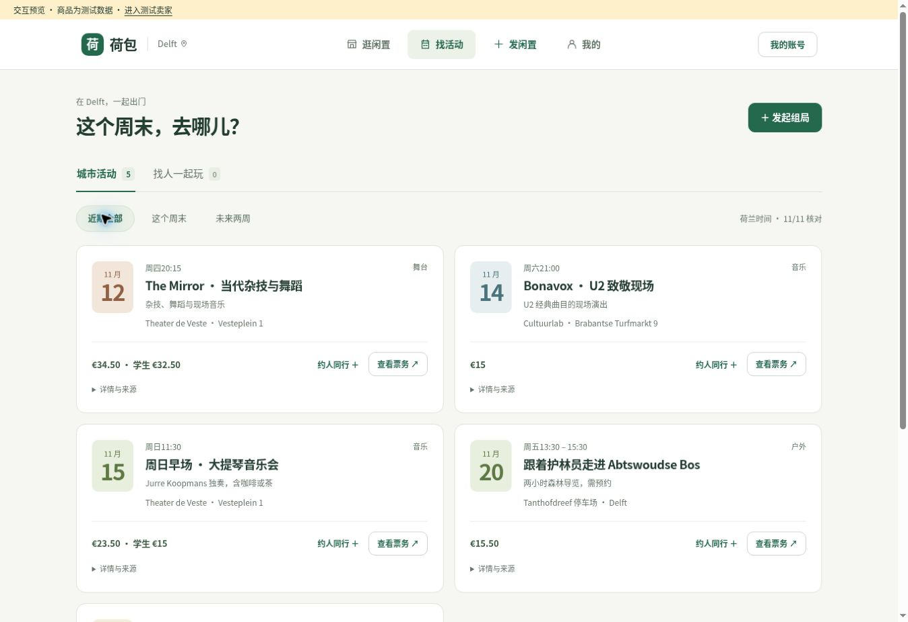
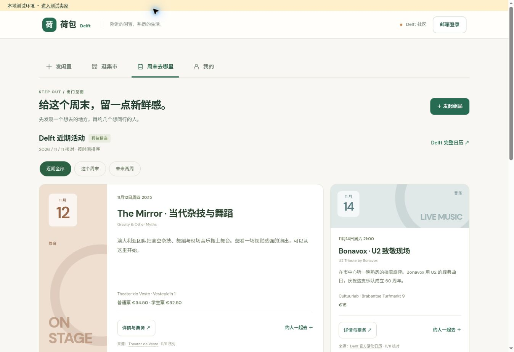

# 荷包 · Delft MVP v0.4

面向 Delft 中国留学生与年轻工作者的毕业清仓工具：在荷包整理商品，把文案、海报和清仓链接分享到原来的微信群，再通过同一链接维护最新库存。

本模块接入现有 Vercel + Turso 项目，入口是 `/delft/`。保留原首页、账号体系、邮箱登录接口和现有依赖。周末页同时提供 Delft 活动精选和用户自主组局。

## v0.4：先看内容，按需展开说明

默认进入「逛闲置」，单件商品卡片展示对应名称、价格与照片。导航统一为「逛闲置 / 找活动 / 发闲置 / 我的」。发布分为添加商品与分享发布两步；城市活动使用紧凑卡片，社区组局通过页内切换直接访问。

新增价格排序、匹配商品置顶、表单定位校验、浏览器返回、我的组局入口、按需登录后继续原操作。去掉重复宣传和外部字体请求，完整来源及可选信息使用折叠展开。海报推广保留小字号署名与二维码。

详细问题、已完成改动和后续方案见 [用户体验检查](docs/UX_REVIEW_2026-11-12.md)。21 项测试通过；桌面和手机尺寸的交互检查使用隔离测试服务，真实第三方服务仍需联调。



## v0.3 的变化

- **页面层级**：缩短欢迎区，明确「发闲置 / 逛集市 / 周末去哪里 / 我的」四个入口。手机采用底部导航，发布表单保持三个步骤，桌面右侧显示实时清单预览。
- **集市浏览**：价格、在售件数、商品名、自取区域分层展示；空结果提供清除筛选或发布入口。
- **分享海报**：先预览再下载，支持手机长按保存；支持 Web Share 文件分享的浏览器显示分享按钮。1–12 件商品全部进入海报，长名称自动换行，保留预订/售出标识。
- **轻量推广**：底部附小字号「荷包 · Delft」、公开网址与二维码，不覆盖商品照片。未发布或有未保存修改时通向首页；已保存的清仓页通向对应商品链接。
- **城市活动**：加入 2026-11-11 核对的五项活动（舞台、音乐、户外和节日），展示来源、核对日期、地点和票务信息。支持本周末/未来两周筛选，已开始的场次自动隐藏，无结果时保留官方日历入口。
- **约人同行**：官方活动卡片可预填组局标题、时间、地点、费用和来源链接。票务与社区报名明确区分。访客可先填写，发布时再登录。
- **当地时间**：集合时间明确采用 `Europe/Amsterdam`，不受设备时区影响；对夏令时跳过的时间给出提示。



## 活动内容维护

精选内容在 `delft/city-events.js`，是人工核对的活动清单，不是实时票务接口。增加或更新活动时，一起更新 `startsAt`、`endsAt`（已知才填）、`price`、`fee`（卡片简写）、`summary`、`sourceUrl` 和 `checkedOn`。日期带上荷兰当日 UTC 偏移；同步修改页面顶部的 `CITY_EVENTS_CHECKED`。

只收录可以在场馆、主办方或 Delft 官方活动日历核对的场次，不把示例组局当成真实用户内容。标题和简介是荷包整理，来源保留在每张卡片上。过去的开始时间不会继续显示，也不会自动滚动到下一周；精选过期后仍可访问 [Delft 官方日历](https://www.indelft.nl/nl/uitagenda/uitagenda-delft)。

## 海报入口与依赖

`delft/site-config.js` 的 `PUBLIC_SITE_URL` 是公开推广入口，当前为仓库配置的生产域名 `https://hebao-backend.vercel.app/delft/`，不会把 Vercel 受保护的预览域名印上海报。**本 PR 合并到生产并部署 `/delft/` 后，海报入口才生效**；预览阶段生成的海报用于验收。更换自定义域名时需同步修改该常量，已下载的海报内容不会改变。

二维码在浏览器本地生成，使用随代码固定的 [qrcode-generator 2.0.4](https://github.com/kazuhikoarase/qrcode-generator/tree/js2.0.4)，原始文件为 `js/dist/qrcode.mjs`（Git blob `444522524987df3a4e37c2a5150dc5c8a052bd44`）。MIT 许可保留在 `delft/vendor/qrcode-LICENSE`。没有第三方二维码生成请求或额外运行时安装步骤。

## v0.2 的变化

- **刷新不丢草稿**：商品照片、名称、价格、分类和发布信息保存在浏览器 IndexedDB；刷新后恢复。新建会清除当前草稿，退出登录也会清除，已发布清仓页保留。
- **发布后继续编辑**：在「我的」打开清仓页，可调整价格、描述、商品与自取区域；保存后沿用原来的分享链接，并保留预订/售出状态。发布成功后再次点击保存会更新原页，不重复创建。
- **在售商品筛选**：支持家具、自行车、数码、生活用品、书籍、其他六类与关键词搜索；服务端在分页截断前筛选同一件在售商品。售出、预订和 14 天未确认的清仓页不进入默认集市。
- **确认仍在售**：卖家可重新确认库存，使过期清仓页回到集市。分享链接始终可访问，包括已售或过期商品。
- **状态与分享**：分享页每次打开都会读取最新数据，也可手动刷新状态；可针对某件商品预填咨询。生成的文案和海报包含预订/售出标识。
- **并发保护**：编辑使用更新时间校验，多窗口旧版本保存返回 409；状态更新也检查快照，避免覆盖其他窗口刚改过的库存。
- **校验与登录体验**：无效 JSON、非法价格和重复商品编号返回 400；失效登录返回登录状态；从商品详情打开登录弹窗时保持正确层级，支持键盘焦点与 Escape 关闭。

## 目录与部署

```text
delft/
  index.html
  styles.css
  app.js
  draft-store.js
  city-events.js
  poster.js
  site-config.js
  vendor/qrcode.mjs
  vendor/qrcode-LICENSE
api/
  _delft-db.js
  delft.js
  delft-ai.js
  delft-upload.js
tests/
  api-test.mjs
  frontend-test.mjs
  helpers/mock-turso.mjs
```

这批代码必须按上述目录部署；API 文件不应放在仓库根目录。`api/_auth.js`、`api/send-auth-email.js`、`api/verify-auth-code.js` 使用原项目版本。

Vercel 预览发布使用功能分支。部署后打开预览地址的 `/delft/`，先完成下面的验收，再合并到 `main`。

数据库沿用现有四张 `delft_*` 表，首次访问时按需创建表和索引。商品分类存放在现有 JSON 字段中，无需修改表结构；旧商品未指定分类时归入「其他」。

## 环境变量

变量名见 `.env.example`，实际值在 Vercel 项目设置中配置：

- 数据与登录：`TURSO_DATABASE_URL`、`TURSO_AUTH_TOKEN`、`JWT_SECRET`、`RESEND_API_KEY`。
- AI：`GEMINI_API_KEY`。
- 图片：`COS_SECRET_ID`、`COS_SECRET_KEY`、`COS_BUCKET`、`COS_REGION`。

本分支移除 Git 当前版本中的 `.env` 并保留忽略规则。原历史中的凭据仍可能被访问；需要在服务商后台撤销、轮换，再更新 Vercel 变量。删除当前文件不等于撤销令牌。

## 本地检查

需要 Node.js 22.13+（内置 SQLite），测试不访问外网，也不使用真实数据库、邮件或图片存储。

```bash
npm run test:delft
npm run check:delft
```

11 项集成测试覆盖：访客/登录鉴权、非法输入、创建与图片 URL 校验、编辑归属和版本冲突、售出隐藏但分享保留、分类与搜索、旧数据兼容、过期与重新确认、并发状态保护、私信隔离、活动人数与取消、删除权限和关联私信。测试使用真正的 `api/_auth.js`，SQL 在内存 SQLite 上执行。

7 项前端逻辑测试覆盖：活动来源完整性、过期隐藏、周末与两周日期边界、荷兰时区与夏令时、组局预填、1–12 件海报布局、已发布/未保存草稿的二维码目标。共 18 项测试通过，语法检查通过。

已在本地桌面浏览器验证草稿刷新恢复、发布与再次编辑保持同一链接、售出状态保留、售出分享页、分类价格筛选和登录弹窗层级。浏览器验证使用隔离的测试数据；真实邮件、Gemini、COS 与 Turso 需要在 Vercel Preview 中继续联调。

v0.3 已通过桌面和 390px 窄屏预览检查：活动卡片、底部导航、周末筛选、组局预填和海报弹窗。实际下载的 12 件测试商品海报为 1000×1932 JPEG；独立 ZXing 解码器在 1000、750、500 像素宽度下均识别出正确首页 URL。窄屏检查是桌面浏览器 iframe，不能替代微信内置浏览器和 iOS 原生分享验收。

## 预览验收

1. 不登录添加一件商品、填写价格，等待「草稿已保存」后刷新，检查照片和字段恢复。
2. 邮箱登录后发布清仓页，记录链接。修改价格再次保存，确认链接不变，「我的」只有一条对应记录。
3. 将商品标为「已预订」或「已售出」，再打开编辑，确认状态保留；通过原链接检查最新库存。
4. 用两个窗口打开同一清仓页编辑。窗口 A 保存后，窗口 B 保存应提示重新打开编辑，不覆盖 A 的变更。
5. 检查分类和搜索：不能因匹配到已售商品名而把同清仓页中不相关的在售商品当作结果。
6. 使用两个测试账号验证咨询、回复、权限隔离与活动人数限制。
7. 实测照片上传/公开访问、Gemini 识别和邮件验证码送达；手机浏览器与微信内置浏览器分别检查上传、复制和保存海报。

## 现有试点边界

- 删除清仓页会删除数据库中的关联私信，COS 图片对象尚未自动删除；公开推广前补齐存储生命周期策略、隐私政策和数据删除渠道。
- 旧网站的私信读取接口、邮箱验证码节流和重试控制仍需单独审计；本模块不调用旧私信读取接口。
- 组局尚无自动通知、群聊、身份核验或人工审核；由组织者通过已有渠道协调。
- 照片仅在点击 AI 识别时发送至 Gemini，在公开发布时上传 COS；本地草稿不会自动上传。微信文案和海报由用户自行分享。
- 没有支付、交易担保、付费会员、自动群发、算法匹配或微信群聊天采集。
