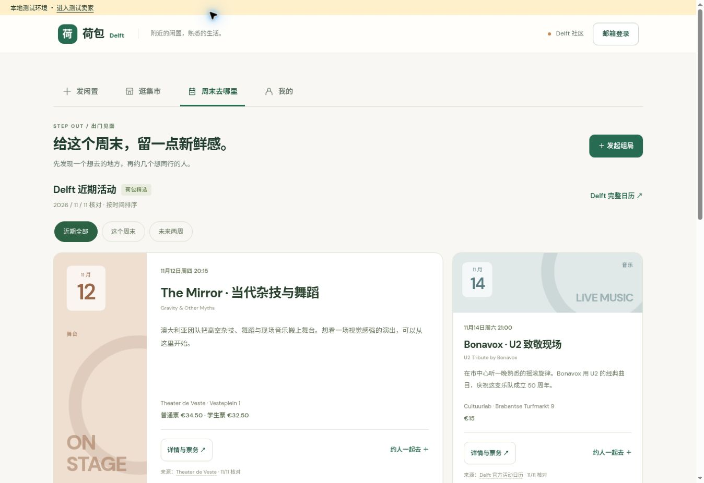
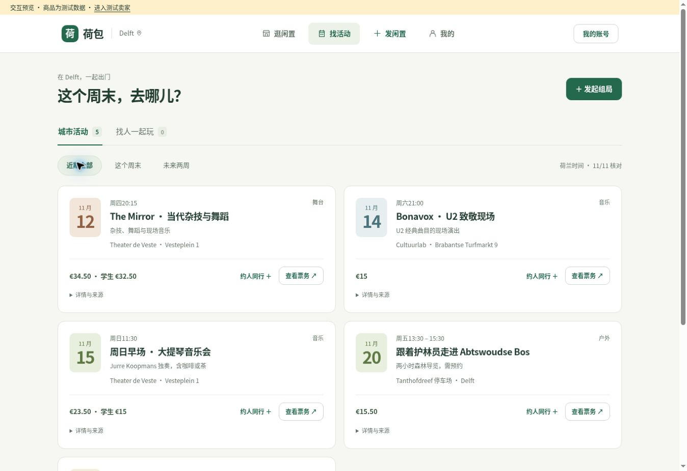
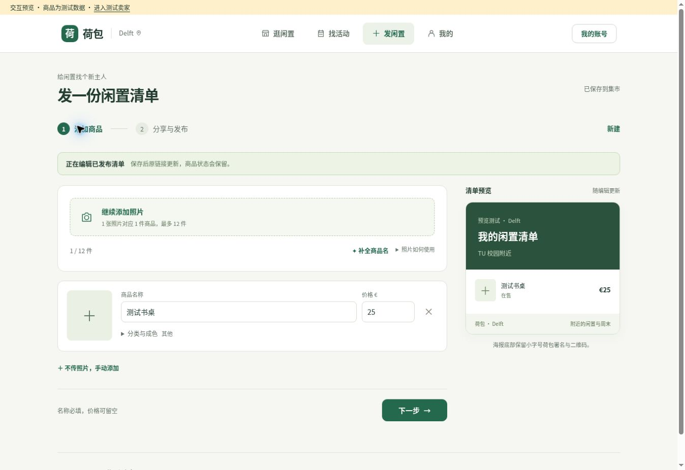

# 荷包 Delft：用户体验检查与改版

检查对象：PR #1 的 v0.3 页面与交互；改版为 v0.4。日期：2026-11-12。

核心判断：用户需要先找到商品、活动或上传入口。旧版把宣传、操作说明、信任提示和实际内容同时铺开，导致阅读负担大、关键内容靠下。新版让内容先出现，把解释移到对应操作处。

这是基于页面、代码和实际操作的体验检查。优先级表示预计影响，不是用户实验或转化率测量；上线后仍需用真实用户验证。

## 已落实到这版的修改

| 优先级 | 原问题与用户影响 | 修改方案与结果 |
|---|---|---|
| P0 | 首次打开直接进入卖家表单，想逛商品或找活动的人要先切换 | 默认进入「逛闲置」，发布保留明显入口；分享链接仍直接打开商品或组局 |
| P0 | 欢迎横幅、英文眉题、宣传标题和说明层层重复，操作入口靠下 | 移除大横幅与英文装饰文案；导航收进顶部，每页保留一个主标题 |
| P0 | 搜索自行车时，清单封面和最低价可能来自同一清单的其他商品 | 按单件在售商品显示匹配结果，名称、照片和价格一致；点击后把该商品置顶并预填咨询 |
| P0 | 用户须同时面对上传、逐件信息、联系信息、复制、海报和发布 | 拆成「添加商品 → 分享与发布」两步，可返回修改；分类、成色、补充说明按需展开 |
| P0 | 活动卡片有大块英文装饰、双语标题、长介绍、重复日期和来源 | 保留日期、名称、一句简介、地点和费用；原文标题、完整说明、核对记录放入「详情与来源」 |
| P0 | 社区组局排在全部场馆活动下方，手机要滚动很久 | 「城市活动 / 找人一起玩」直接切换，两类内容都有时间筛选 |
| P1 | 同时存在多组宣传入口，导航名称偏长 | 统一为「逛闲置 / 找活动 / 发闲置 / 我的」；手机固定底部导航 |
| P1 | 分享与公开上架混在同一组按钮里，不易理解区别 | 将「分享到微信」与「公开发布到集市」分开；生成海报为分享区主操作 |
| P1 | 「需要登录」反复出现在按钮和说明中；验证成功后得重新找按钮 | 按钮只描述动作，点击发布、咨询或报名时再登录；实现登录后继续原操作 |
| P1 | AI 提示占据上传区；12 件商品只识别前 8 张 | AI 作为可选辅助；照片用途折叠说明；未命名照片按每批 8 张处理，覆盖最多 12 件 |
| P1 | 「毕业清仓」默认文案让普通转让显得不合适 | 默认改为「我的闲置清单」，覆盖一件闲置、日常转让和整屋清仓 |
| P1 | 缺少名称或价格不合法时只有笼统提示 | 明确指出第几件商品，在字段上标记并聚焦，填写内容保留 |
| P1 | 浏览时只能看清单起价，缺少价格比较 | 加入最近更新、价格从低到高排序；免费显示为免费，未知价格不误显示为 €0 |
| P1 | 官方票务和社区报名容易混淆 | 官方活动按钮使用「查看票务 / 官方安排」；「约人同行」进入预填表单，并明确门票自理 |
| P1 | 组局表单在长页面底部，点击后视线跳转很远 | 改为当前页面的弹窗，支持关闭与键盘操作，输入草稿保留 |
| P1 | 「我的」把商品、整段私信混在一起，承诺的报名信息却没有入口 | 增加「我的闲置 / 我的组局 / 私信」分区；展示已报名和自己发起的有效组局 |
| P1 | 切换页面只替换 URL，浏览器返回不能回到上一功能 | 使用浏览器历史；商品详情地址包含具体清单和商品，后退可关闭详情 |
| P1 | 多处警示反复出现，降低正常阅读的连贯性 | 公开信息说明留在发布处；地址提醒留在自取区域；通用提示收进页脚「使用与安全」 |
| P1 | 加载失败与没有内容容易混淆，部分错误没有就地操作 | 失败状态提供重试；筛选无结果提供清除；社区加载失败独立于城市活动 |
| P1 | 视觉层级弱：太多绿色小字、相似标题、重复边框和大空白 | 收敛字级、按钮样式和间距；商品价格、活动标题与时间优先，去掉倾斜预览和装饰大块 |
| P2 | 字体依赖外部 Google Fonts，增加首屏请求 | 使用系统字体，不新增字体下载 |
| P2 | 折叠后的控件仍可能进入弹窗焦点循环 | 焦点循环只包含可见、可用控件，并纳入折叠标题 |
| P2 | 验证码重复发送缺少明确反馈 | 增加发送状态、自动聚焦验证码、60 秒客户端重发倒计时；服务端限流仍由现有接口负责 |
| P2 | 手机页在改版初次测试时底部导航受顶部背景滤镜影响 | 移除手机顶部滤镜，验证导航固定在视口底部，商品页无水平溢出 |

## 仍需要继续解决的问题

下面这些问题影响产品的完整体验，不能靠减少文字解决，本轮没有把它们描述成已完成。

| 优先级 | 问题 | 下一步方案 |
|---|---|---|
| P0 | 私信没有未读提示、推送或邮件提醒，用户可能一直等不到回复 | 先加未读状态和导航数字，再做用户可选择的邮件提醒；记录已读时间，避免重复提醒 |
| P0 | 组局只有报名昵称，没有组织者与参与者的联系闭环 | 建立活动内讨论或组织者公告，报名成功后显示集合信息；变更与取消通知参与者 |
| P0 | 冷启动时缺少真实商品与真实组局；好看但空的列表留不住人 | 小范围邀请真实卖家提交第一批内容；保留真实空状态，精选活动提供稳定内容，不伪造活跃人数 |
| P0 | 缺少举报、屏蔽和内容审核入口 | 在商品、用户和活动详情中提供举报；补后台审核、处理记录与联系入口 |
| P1 | 活动目前为人工精选，到期后没有新的场次自动补充 | 建立每周核对流程或管理后台；有许可的官方数据源可接入，但发布前仍核验时间、地点与票价 |
| P1 | 一件商品只有一张照片，成色细节不充分；图片缺少放大浏览 | 支持一件商品多图和详情放大，首图用于卡片与海报，其余图片留在详情 |
| P1 | 一次读取最多 100 份清单，价格排序只覆盖已读取结果 | 数据增长后把商品级排序和分页移到服务端；明示加载更多，避免用户误认为已搜全站 |
| P1 | 无收藏、稍后查看功能 | 先实现账号收藏，兼容访客本地收藏；新增消息优先于复杂推荐系统 |
| P1 | 地点是文字，不能估计距离；活动没有加入日历 | 增加公共地标地图链接与日历导出；不把卖家精确住址公开 |
| P1 | 草稿只在当前浏览器，换设备无法接续；退出登录会清空草稿 | 退出前提示未发布内容；后续增加账号草稿或导出恢复，明确本地与云端保存状态 |
| P1 | 活动不能便利地修改安排；取消后页面消失，已报名用户可能错过变化 | 保存活动历史及取消状态，提供组织者编辑；重大时间地点修改通知参与者 |
| P1 | 邮箱验证、图片上传、AI、数据库的真实生产链路尚未完整联调 | 在部署环境用测试账号走完发布、私信、报名、上传和失败重试；实际检查微信/iOS 分享 |
| P2 | 移动端侧栏预览不显示；当前分享阶段可生成真实海报查看 | 后续加可展开清单预览，但避免在每件商品下重复显示一份完整清单 |
| P2 | 没有真实用户完成时间和流失证据，无法确认哪些改动提升了效果 | 找 5 位目标用户完成“找一辆车并咨询、发布两件闲置、找周末活动并约人”任务；观察卡点、误点和完成率 |

建议下一轮先完成「消息提醒 + 组局沟通」，再补「活动维护 + 真实内容运营」。它们决定用户能否真正完成一次交易或见面。

## 页面实景

旧版活动页：

新版活动页：

新版商品编辑：

手机布局检查：

截图来自本地交互测试环境，商品为测试数据，城市活动来自已有的核对清单。保持相近桌面窗口观察，旧版首屏主要显示前两场活动，新版可完整比较四场活动的关键内容。

## 验证范围

- 21 项自动测试通过：11 项 API 集成测试和 10 项前端逻辑测试；语法检查通过。
- 浏览器检查：活动筛选及同行预填、商品搜索与详情匹配、返回关闭详情、名称字段校验、两步编辑、海报生成、测试清单发布与「我的」分区。
- 手机检查：390px iframe（内容可视宽度 375px），底部导航、活动卡片、商品列表和无水平溢出；未代替真机测试。
- 登录门槛已验证，真实邮件验证码及登录后自动接续没有通过真实邮件环境验收。测试发布使用隔离的测试会话和内存数据库。
